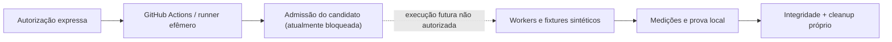

# Public Synthetic Runner LAB

**Laboratório público e independente para validar, com dados artificiais, limites de execução, isolamento e segurança em runners efêmeros do GitHub Actions.**

**Nenhum dado privado, alvo real ou teste ofensivo é autorizado neste repositório.**

[Arquitetura](docs/ARCHITECTURE.md) · [Evidências](docs/STATUS-AND-EVIDENCE.md) · [Segurança](docs/SECURITY-AND-CUSTODY.md) · [Continuidade](docs/HANDOVER.md)

---

## Índice

- [O que é](#o-que-é)
- [Como funciona](#como-funciona)
- [Experiências e evidências](#experiências-e-evidências)
- [Candidato integral](#candidato-integral)
- [Arquitetura](#arquitetura)
- [Segurança e custódia](#segurança-e-custódia)
- [Estado real](#estado-real)
- [Roadmap](#roadmap)
- [Como começar](#como-começar)
- [Para quem vai continuar](#para-quem-vai-continuar)

## O que é

Um ambiente **público, separado de qualquer infraestrutura institucional**, usado para responder a uma pergunta delimitada: quais restrições de isolamento, recursos, parada e limpeza podem ser demonstradas com exemplos inteiramente sintéticos no runner padrão do GitHub Actions?

O laboratório **não** é um produto de segurança, uma plataforma para pentest em terceiros ou um ambiente de homologação aprovado. Resultados de workflows precisam ser interpretados dentro do caso efetivamente executado.

## Como funciona

1. Uma alteração candidata é fixada por **branch + commit SHA**.
2. Cenários usam exclusivamente fixtures artificiais, sem credenciais ou ativos reais.
3. Cada experimento deve delimitar runner, containers, tempo, recursos e ownership.
4. Uma execução só pode ocorrer com **autorização expressa separada**. O candidato integral atual está deliberadamente desabilitado.
5. Logs públicos e resultados são classificados sem confundir **sucesso de smoke** com **aprovação operacional**.

## Experiências e evidências

| Etapa | O que foi observado | Situação |
| --- | --- | --- |
| E01 | Inventário do runner efêmero | [SUCCESS sintético](https://github.com/jorgemunizoficial/lab-runner-validation/actions/runs/40152605636) |
| E02 | Worker Docker com escopo artificial | [SUCCESS sintético](https://github.com/jorgemunizoficial/lab-runner-validation/actions/runs/40153095163) |
| E03 | Restrições de processo, memória, filesystem e parada | [SUCCESS sintético](https://github.com/jorgemunizoficial/lab-runner-validation/actions/runs/40153350108) |
| E04 | Watchdog local e limpeza | [SUCCESS sintético](https://github.com/jorgemunizoficial/lab-runner-validation/actions/runs/40159327555) |
| E05 | T1–T4 sintéticos | [SUCCESS sintético](https://github.com/jorgemunizoficial/lab-runner-validation/actions/runs/40172457827) |
| E06 | T5–T8 sintéticos | [SUCCESS sintético](https://github.com/jorgemunizoficial/lab-runner-validation/actions/runs/40173168955) |
| E07 | T9–T12 sintéticos | [SUCCESS sintético](https://github.com/jorgemunizoficial/lab-runner-validation/actions/runs/40173447134) |

**Atenção:** são sete runs pontuais, não uma campanha integral de aceitação N1–N8. Um watchdog dentro do mesmo runner não foi demonstrado como supervisor independente; `--network none` em container não demonstra egress negado no host.

Veja [Estado e evidências](docs/STATUS-AND-EVIDENCE.md).

## Candidato integral

O arquivo `.github/workflows/lab-batch-validation.yml` possui um **candidato imobilizado em branch própria**, publicado no commit:

`3a2054467c741138531a95104fee351ade614d48`

[Consultar o candidato fixado](https://github.com/jorgemunizoficial/lab-runner-validation/blob/3a2054467c741138531a95104fee351ade614d48/.github/workflows/lab-batch-validation.yml).

O job mantém a condição literal `if: ${{ false && ... }}` e gatilho `workflow_dispatch` exclusivo. **A apresentação do repositório não altera nem habilita esse candidato.**

## Arquitetura

A figura é **conceitual**, não prova de execução integral ou independência do plano de controle.

[Detalhamento técnico da arquitetura](docs/ARCHITECTURE.md).

## Segurança e custódia

- **Sem dados privados ou de terceiros:** apenas valores fictícios e conteúdo publicável.
- **Sem exportação institucional:** nunca importar código, documentação, credenciais ou registros de ambientes privados.
- **Ownership:** parar e limpar somente o próprio cenário; preservar recursos alheios.
- **Limites realmente impostos:** diferenciar restrição aplicada de variável declarada.
- **Não atribuir cobertura inexistente:** hash não prova autoria ou validade jurídica; falha HTTP não prova bloqueio de todo egress.
- **Execução separadamente autorizada:** nenhuma instrução deste README inicia testes.

Veja [Segurança e custódia](docs/SECURITY-AND-CUSTODY.md) e [Governança](docs/GOVERNANCE.md).

## Estado real

| Dimensão | Situação |
| --- | --- |
| Ensaios E01–E07 | `SUCCESS` no âmbito sintético |
| T1–T12 | Provas limitadas aos cenários sintéticos executados |
| Candidato de workflow integral | `CREATED_PUBLIC_NOT_EXECUTED` |
| N1–N8 em campanha nativa | **`NOT_EXECUTED`** |
| Isolamento, supervisão e cadeia integrais | **`NOT_PROVEN`** |
| Aprovação operacional | **`NO_GO / HOLD`** |

Nenhum badge ou gráfico substitui evidência verificável.

## Roadmap

**M1 — Revisão estática consolidada:** conferir guard, limites, recursos próprios e cobertura do código.

**M2 — Decisão de autorização:** verificar custos, contenção e mecanismos de segurança sem presumir aptidão do runner.

**M3 — Campanha nativa integral:** executar N1–N8 somente se explicitamente autorizado em ato futuro.

**M4 — Revisão independente:** confrontar logs, manifesto, resíduos e critérios antes de alterar status.

[Roadmap detalhado](docs/ROADMAP.md).

## Como começar

Este repositório não requer instalação para **leitura e auditoria documental**. Consulte:

- [Regras para agentes](AGENTS.md)
- [Governança](docs/GOVERNANCE.md)
- [Arquitetura](docs/ARCHITECTURE.md)
- [Evidências](docs/STATUS-AND-EVIDENCE.md)
- [Continuidade / handover](docs/HANDOVER.md)

**Não execute workflows nem altere o arquivo candidato por causa deste guia.** A decisão operacional permanece bloqueada até autorização expressa.

## Para quem vai continuar

Agentes e revisores futuros devem confirmar primeiro o commit exato, as permissões e os limites de sua missão. Uma conexão com GitHub de uma sessão não demonstra automaticamente permissões em outra. Preserve os sete resultados históricos; classifique lacunas como `NOT_PROVEN` ou `NOT_EXECUTED` até prova correspondente.

**HOLD — PUBLIC SYNTHETIC LAB / NO_GO_OPERATIONAL.**
