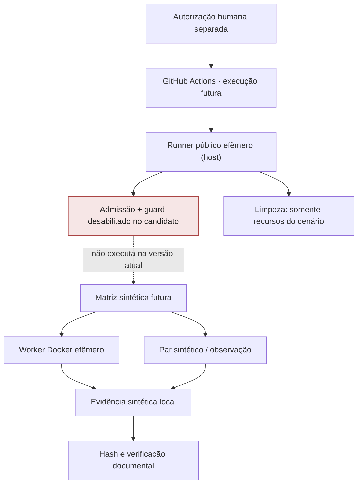

# Arquitetura — laboratório público sintético

**Situação:** exploração de runner efêmero; não é arquitetura operacional aprovada.

## Componentes e limites

## Limites reais

- **Host GitHub Actions:** hospeda o processo e tem dependências de rede/serviço; o host não foi certificado como air gap. Inventários observados em um run não garantem capacidade de qualquer outro.
- **Worker Docker:** experiências anteriores usaram `--network none`, `--cap-drop ALL`, `--read-only`, `--security-opt no-new-privileges`, usuário não root e quotas. Isso **não comprova isolamento do host inteiro**, nem supervisor independente.
- **Controle de admissão:** o arquivo candidato em branch separada possui `workflow_dispatch` e `if: ${{ false && ... }}`. Isso impede o job na versão fixa; não habilitar durante mudanças de apresentação.
- **F1–F4:** preservar fundação e terceiros; estabelecer ownership, inventário e cleanup apenas dos recursos criados pelo cenário.
- **L2:** limites de CPU, memória, tempo, dados e rede devem estar **efetivamente impostos**, não apenas declarados em variáveis.
- **N1–N8:** requisitos de validação integral ainda não executados como campanha nativa; nenhum smoke substitui o teste de aceitação correspondente.

## Superfícies Git

| Área | Papel | Estado |
| --- | --- | --- |
| `main` | Histórico dos ensaios sintéticos E01–E07 | Preservado |
| `lab/hsinf01-integral-executor-candidate-20261025` | Único candidato integral fixado | Inerte / sem execução |
| `docs/public-lab-repository-presentation-20261026` | Organização documental pública | Sem dispatch |

Consulte [Segurança e custódia](SECURITY-AND-CUSTODY.md) e [Estado e evidências](STATUS-AND-EVIDENCE.md).
